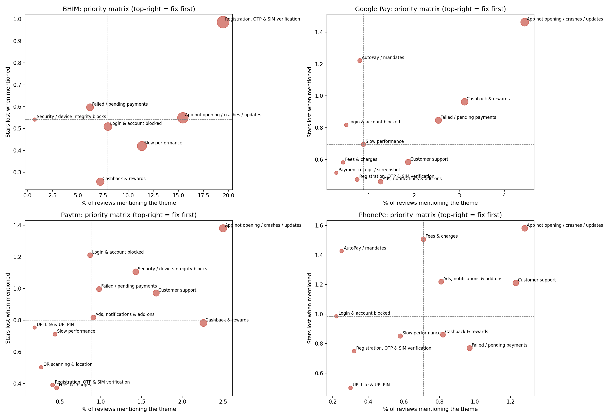
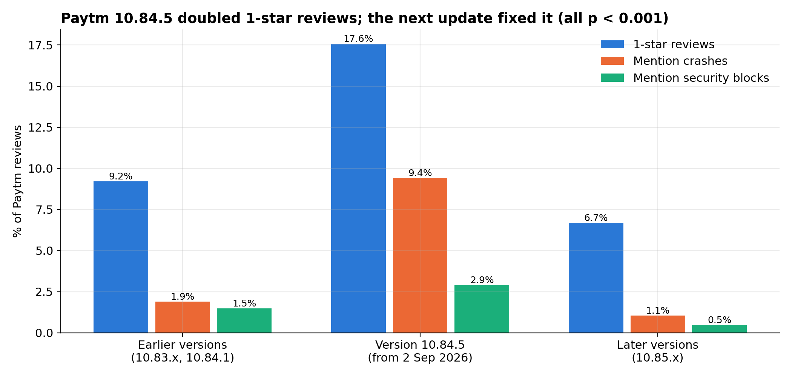

# UPI App Complaint Analytics

**What 86,000 Google Play reviews say India's UPI payment apps should fix first.**

An end-to-end text analytics project on user reviews of BHIM, Google Pay, Paytm and PhonePe. Reviews were
collected with a custom scraper and analysed with classical and transformer-based NLP to answer three
business questions:

1. What do users complain about, and how does this differ between apps?
2. Which problems cost the most in star ratings, and should therefore be fixed first?
3. Can review text detect a problematic app release early?

Capstone project for *24INFS7101 NLP and Text Analytics in Business*.

---

## Contents

- [Data](#data)
- [Method](#method)
- [Results](#results)
- [Interactive dashboard](#interactive-dashboard)
- [Repository structure](#repository-structure)
- [Reproducing the analysis](#reproducing-the-analysis)
- [Limitations](#limitations)
- [Data and privacy](#data-and-privacy)
- [Author](#author)

---

## Data

| App        | Reviews collected |
|------------|------------------:|
| BHIM       | 10,000            |
| Google Pay | 18,221            |
| Paytm      | 27,614            |
| PhonePe    | 30,221            |
| **Total**  | **86,056**        |

- **Source:** Google Play Store (India, English interface), newest reviews, May to October 2026.
- **Collection:** [`src/scrape_reviews.py`](src/scrape_reviews.py), built on `google-play-scraper`. Scraping
  continued until each app had at least 5,000 reviews of five or more words. Short reviews were kept
  to avoid a length bias.
- **Fields:** review text, star rating, helpful votes, app version, date, company reply and reply date.
  Reviewer names were never stored.
- After cleaning and de-duplication, 85,150 reviews were used for modelling.

## Method

| Stage | Techniques |
|-------|------------|
| Preprocessing | Unicode and emoji handling, Hinglish and slang dictionary (about 150 terms), negation-preserving stop-word removal, spaCy lemmatisation, two text versions (light for transformers, full for bag-of-words) |
| Sentiment classification | VADER; TF-IDF + logistic regression; sentence embeddings (MiniLM, English and multilingual) + logistic regression; fine-tuned DistilBERT with class-weighted loss |
| Complaint themes | BERTopic (multilingual embeddings, UMAP, HDBSCAN): 40 topics merged into 15 business themes; benchmarked against LDA using NPMI coherence and topic diversity |
| Business impact | OLS rating-driver regression with robust (HC3) errors and app fixed effects; priority matrix; fix simulation; release monitor with Bonferroni correction; analysis of company replies |
| Delivery | Streamlit and Plotly dashboard |

Labels were derived from star ratings (1–2 negative, 3 neutral, 4–5 positive) with a stratified
70 / 15 / 15 train, validation and test split. All vectorisers and models were fitted on the training set only.

## Results

### Sentiment models (test set, macro F1)

| Model                                   | 3 classes | 2 classes |
|-----------------------------------------|----------:|----------:|
| VADER (lexicon baseline)                | 0.506     | 0.753     |
| TF-IDF + logistic regression            | 0.601     | 0.877     |
| MiniLM embeddings + logistic regression | 0.591     | 0.863     |
| Multilingual embeddings + logistic regression | 0.596 | 0.868 |
| **Fine-tuned DistilBERT**               | **0.643** | **0.896** |

DistilBERT also identified 1,667 complaints hidden behind positive star ratings.

### Topic models

| Model         | NPMI coherence | Topic diversity |
|---------------|---------------:|----------------:|
| LDA (15 topics) | 0.124        | 0.760           |
| LDA (40 topics) | 0.096        | 0.738           |
| **BERTopic**    | **0.168**    | 0.545           |

### Business findings

- **Each app has a different main problem.** BHIM: registration, OTP and SIM verification (37–44% of specific
  complaints). Paytm: security and device-integrity blocks (29–36%). Google Pay: failed or pending payments
  (24–29%). PhonePe: customer support (about 24%).
- **Problems that block users cost the most stars.** Holding app and review length constant, reviews mentioning
  AutoPay carry 1.22 fewer stars, crashes and security lock-outs 1.10, fees 0.86 and OTP problems 0.84, compared
  with 0.52 for slowness.
- **A single release can be detected from reviews.** Paytm version 10.84.5 doubled the share of one-star
  reviews (9.2% to 17.6%) and raised crash mentions from 1.9% to 9.4%. Both returned to normal after the
  next update (p < 0.001). The release monitor flagged it automatically.
- **Response strategies differ widely.** BHIM answers 98% of low-rated reviews, but after a median of
  46 hours and almost always with a template. Google Pay answers 44%.

<p align="center">
  
</p>
<p align="center"><em>Fix-priority matrix per app: how often each complaint theme is mentioned against how many stars it costs. Themes in the top-right corner should be fixed first.</em></p>

<p align="center">
  
</p>
<p align="center"><em>Paytm version 10.84.5: one-star reviews and crash mentions before, during and after the release.</em></p>

All result tables are in [`reports/`](reports) and all figures are in [`reports/figures/`](reports/figures).

## Interactive dashboard

The Streamlit dashboard lets a product team filter by app, date and star rating. It has four views:

- **Trends:** weekly rating and share of negative reviews.
- **Complaint themes:** theme shares and the fix-priority table.
- **Releases:** the release monitor with flagged versions.
- **Review explorer:** search and read individual reviews.

Live version: *link to be added*

## Repository structure

```
upi-complaint-analytics/
├── notebooks/
│   └── upi_complaint_analytics.ipynb   Full analysis (Google Colab, GPU recommended)
├── src/
│   └── scrape_reviews.py               Data collection script
├── dashboard/
│   ├── app.py                          Streamlit application
│   ├── dashboard_data.parquet          Anonymised review data for the dashboard
│   ├── priority_matrix.csv
│   ├── release_monitor.csv
│   └── requirements.txt
├── reports/
│   ├── *.csv                           Result tables
│   └── figures/                        Charts used in the report and presentation
├── requirements.txt                    Packages for the full analysis
└── LICENSE
```

## Reproducing the analysis

**Dashboard (local):**

```bash
git clone https://github.com/manideepak1007/upi-complaint-analytics.git
cd upi-complaint-analytics/dashboard
pip install -r requirements.txt
streamlit run app.py
```

**Full analysis:**

1. Run `python src/scrape_reviews.py` to collect a fresh dataset. Reviews change daily, so counts will differ.
2. Open `notebooks/upi_complaint_analytics.ipynb` in Google Colab and set `BASE` to your working folder.
3. Run the notebook from top to bottom. Fine-tuning DistilBERT needs a GPU; everything else runs on a CPU.

## Limitations

- Dissatisfied users are more likely to write reviews, so results describe complaints, not all users.
- The data covers two to five months per app and English or Hinglish text only.
- The regression shows association, not causation; estimated rating gains are potential, not guaranteed.
- Between 15% and 43% of complaints, depending on the app, do not name a specific problem.

## Data and privacy

The raw scraped reviews are not published. The dashboard data contains review texts only, without review IDs
or reviewer names. Phone numbers, email addresses, UPI IDs and long account-style numbers have been masked.
The data is used for academic analysis only.

## Author

Mani Deepak Mathemsetty
