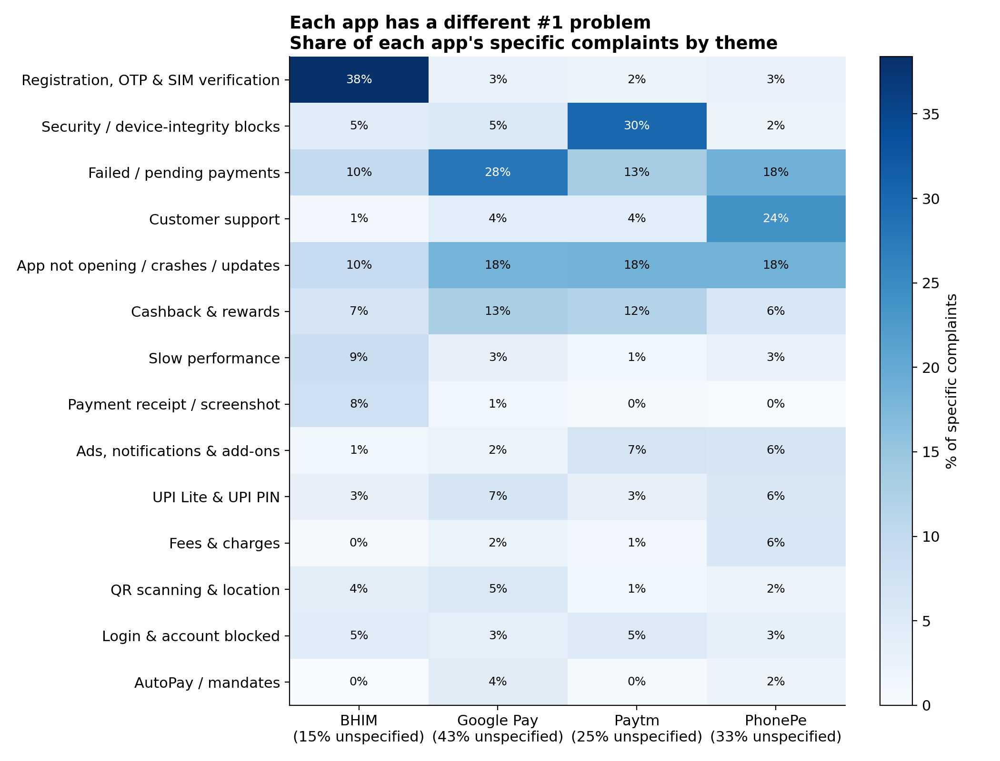
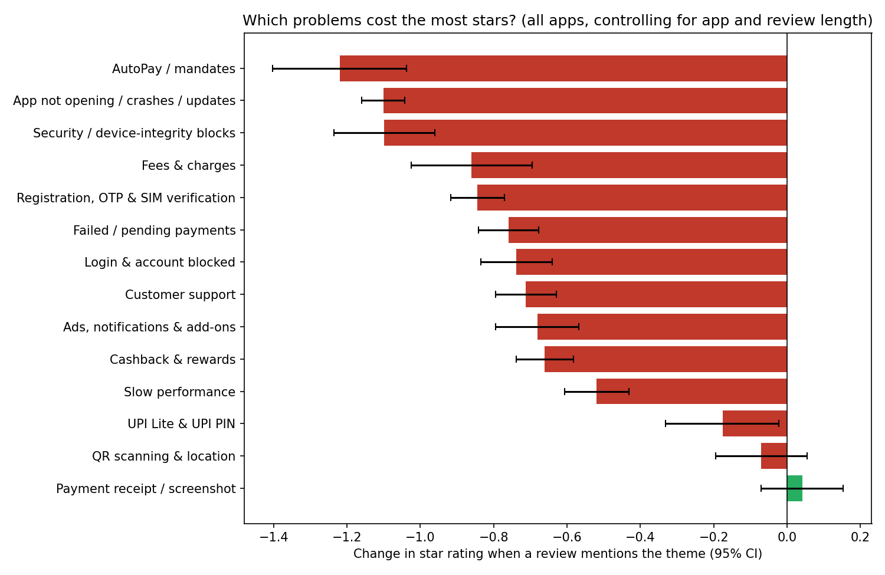

# UPI App Complaint Analytics

**What 86,000 Google Play reviews say India's UPI payment apps should fix first.**

An end-to-end business text-analytics project on user reviews of BHIM, Google Pay, Paytm and PhonePe. The reviews were collected with our own scraper and analysed with classical and transformer-based NLP and with statistical tests, to answer one business question:

> *Which failures drive 1-star reviews for each UPI app, and which fix would lift each app's rating most?*

Capstone project for *24INFS7101 NLP and Text Analytics in Business*.

**Live dashboard:** [https://upi-complaint-analytics.streamlit.app](https://upi-complaint-analytics.streamlit.app)

---

## Contents

- [Project guidelines and where to find them](#project-guidelines-and-where-to-find-them)
- [Key results](#key-results)
- [Data](#data)
- [Method](#method)
- [Interactive dashboard](#interactive-dashboard)
- [Repository structure](#repository-structure)
- [How to reproduce](#how-to-reproduce)
- [Deliverables](#deliverables)
- [Data and privacy](#data-and-privacy)
- [Author](#author)

---

## Project guidelines and where to find them

| Guideline | Where | Summary |
|---|---|---|
| Business problem definition | [00 · Business problem and literature](notebooks/00_business_problem_and_literature.ipynb) | Decision maker, business question, objectives, scope, success criteria |
| Literature support | [00 · Business problem and literature](notebooks/00_business_problem_and_literature.ipynb) | 31 references on app-review mining, UPI, NLP methods and statistics |
| Data collection | [01 · Data collection](notebooks/01_data_collection.ipynb), [`src/scrape_reviews.py`](src/scrape_reviews.py) | Own two-stage scraper, 86,056 reviews |
| Data preprocessing | [02 · Data preprocessing](notebooks/02_data_preprocessing.ipynb) | Negations kept, Hinglish translated, two text versions |
| Feature engineering | [03 · Feature engineering](notebooks/03_feature_engineering.ipynb) | Labels, stratified split, TF-IDF, VADER and metadata features |
| Exploratory text analysis | [04 · Exploratory text analysis](notebooks/04_exploratory_text_analysis.ipynb) | Ratings, length, trends, distinctive words, word clouds |
| Model development | [05 · Sentiment models](notebooks/05_model_development_sentiment.ipynb), [06 · Topic models](notebooks/06_model_development_topics.ipynb), [07 · Business impact and statistics](notebooks/07_business_impact_and_statistics.ipynb) | Fine-tuned DistilBERT, BERTopic vs LDA, regression and hypothesis tests |
| Visualization | [08 · Visualization and dashboard](notebooks/08_visualization_and_dashboard.ipynb), [`dashboard/`](dashboard), [`reports/figures/`](reports/figures) | 15 charts, one interactive heatmap and a 9-view interactive dashboard |
| Business recommendations | [09 · Recommendations, limitations, future work](notebooks/09_recommendations_limitations_future_work.ipynb) | One measured action per app |
| Limitations | [09](notebooks/09_recommendations_limitations_future_work.ipynb) | Self-selection, association vs causation, language coverage |
| Future work | [09](notebooks/09_recommendations_limitations_future_work.ipynb) | Automation, multilingual models, causal tests, more sources |

## Key results

**1. Each app has a different number-one problem** (share of each app's specific complaints)

| App | Average rating | #1 complaint theme | Share |
|---|---|---|---|
| BHIM | 2.7 | Registration, OTP and SIM verification | 37–44% |
| Paytm | 4.5 | Security / device-integrity blocks | 29–36% |
| Google Pay | 4.0 | Failed or pending payments | 24–29% |
| PhonePe | 4.4 | Customer support | about 24% |

**2. Problems that block the user cost the most stars.** A regression on all 85,150 reviews, controlling for app and review length, shows that a review mentioning AutoPay problems has 1.22 fewer stars, crashes 1.10, security blocks 1.10 and fees 0.86, against 0.52 for slowness. Twelve of fourteen problem themes are statistically significant.

**3. What each app should fix first.** Fixing BHIM's onboarding could lift its average rating by about **0.18 stars**, the largest single gain. For Paytm and PhonePe each problem affects only 1–3% of reviewers, but every affected user takes 1 to 1.6 stars off.

**4. A single bad release is visible in the reviews.** Paytm version 10.84.5 nearly doubled the share of 1-star reviews (9.2% → 17.6%); the next update brought it back to 6.7% (p < 0.001). A release monitor tested 38 versions and flagged five as significantly worse.

**5. Reply rate alone is misleading.** BHIM answers 98% of complaints, but after a median of 46 hours and almost always with a template; Google Pay answers 44%.

**6. Early warnings.** PhonePe crash complaints rose by 8.3 percentage points in the last four weeks (significant), while BHIM onboarding complaints fell sharply.

<p align="center">
  
</p>
<p align="center"><em>Share of each app's specific complaints by theme.</em></p>

<p align="center">
  
</p>
<p align="center"><em>Stars lost when a review mentions each problem (95% confidence intervals).</em></p>

**Model quality**

| Sentiment model (test set) | Macro F1, 3 classes | Macro F1, 2 classes |
|---|---|---|
| VADER (lexicon baseline) | 0.506 | 0.753 |
| TF-IDF + logistic regression | 0.601 | 0.877 |
| Sentence embeddings + logistic regression | 0.591–0.596 | 0.863–0.868 |
| **Fine-tuned DistilBERT** | **0.643** | **0.896** |

DistilBERT is significantly better than TF-IDF on the same test reviews (McNemar χ² = 556, p < 0.001). For topic modelling, BERTopic's topics are more coherent than LDA's (NPMI 0.168 vs 0.124).

All statistical tests are summarised in [`reports/statistical_tests/`](reports/statistical_tests).

## Data

| App | Reviews | Period (2026) |
|---|---|---|
| BHIM | 10,000 | 21 Jun – 14 Oct |
| Google Pay | 18,221 | 18 May – 18 Oct |
| Paytm | 27,614 | 26 Jul – 18 Oct |
| PhonePe | 30,221 | 19 Aug – 18 Oct |
| **Total** | **86,056** | |

Public Google Play Store reviews (India, English interface), collected until every app had at least 5,000 reviews of five or more words. Full description: [docs/dataset_description.md](docs/dataset_description.md). Column definitions: [data/README.md](data/README.md).

## Method

| Stage | Techniques |
|---|---|
| Preprocessing | Emoji handling, Hinglish dictionary, negation-preserving stop-word removal, spaCy lemmatisation |
| Features | Star-based labels, stratified 70/15/15 split, TF-IDF, VADER score, metadata features, sentence embeddings |
| Sentiment | VADER, TF-IDF + logistic regression, MiniLM embeddings + logistic regression, fine-tuned DistilBERT |
| Complaint themes | BERTopic (UMAP, HDBSCAN, c-TF-IDF), 40 topics merged into 15 business themes; compared with LDA |
| Business impact | OLS rating-driver regression (HC3), priority matrix, fix simulation, release monitor (Mann-Whitney, Bonferroni), chi-square tests, McNemar test |
| Delivery | Streamlit and Plotly dashboard |

## Interactive dashboard

Nine views for a product team: Overview, Trends, Complaint themes, Fix priorities (with a "what if we fixed it" calculator), Releases (with a live release investigator), Emerging topics, Company replies, Models & tests, and a Review explorer with CSV download.

Live version: [https://upi-complaint-analytics.streamlit.app](https://upi-complaint-analytics.streamlit.app)

Run it locally:

```bash
git clone https://github.com/manideepak1007/upi-complaint-analytics.git
cd upi-complaint-analytics/dashboard
pip install -r requirements.txt
streamlit run app.py
```

## Repository structure

```
upi-complaint-analytics/
├── notebooks/                    analysis, one notebook per project guideline (00–09)
├── src/
│   └── scrape_reviews.py         data collection script
├── dashboard/                    Streamlit app, its data and requirements
├── reports/
│   ├── figures/                  all charts (PNG, one interactive HTML)
│   ├── tables/                   result tables (models, themes, text statistics, replies)
│   └── statistical_tests/        every statistical test, with a plain-language summary
├── data/
│   └── README.md                 data dictionary (raw data is not published)
├── docs/                         dataset description and project documents
├── requirements.txt
└── LICENSE
```

## How to reproduce

1. **Collect data:** `python src/scrape_reviews.py` (reviews change daily, so counts will differ).
2. **Run the analysis:** open the notebooks in Google Colab in order (01 → 08), with the project folder at `MyDrive/upi-complaint-analytics`. A GPU is needed only for notebook 05 (DistilBERT fine-tuning and embeddings) and the embedding step in 06.
3. **Read the conclusions:** notebook 09 runs anywhere, directly on the saved result tables.

Packages: [`requirements.txt`](requirements.txt).

## Deliverables

| Deliverable | Location |
|---|---|
| Dataset description | [docs/dataset_description.md](docs/dataset_description.md) |
| Python notebooks | [notebooks/](notebooks) |
| Source code | [src/](src), [dashboard/](dashboard) |
| Live dashboard | [https://upi-complaint-analytics.streamlit.app](https://upi-complaint-analytics.streamlit.app) |
| Final report | docs/ (to be added) |
| Presentation | docs/ (to be added) |

## Data and privacy

Only public reviews were collected, at a slow request rate. Reviewer names were never stored. The raw and processed review files are not published; the dashboard data contains review texts without review IDs, with phone numbers, email addresses, UPI IDs and long account-style numbers masked. The data is used for academic analysis only.

## Author

Mani Deepak Mathemsetty

## License

Code released under the [MIT License](LICENSE).
